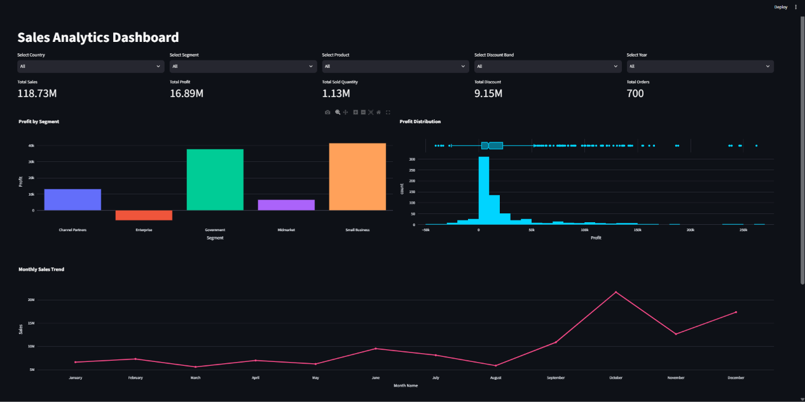

# 📊 SalesScope - Sales Analytics Dashboard

An interactive sales analytics dashboard built with **Streamlit** and **Plotly**. It lets you filter sales data and instantly see key business metrics and charts.

🔗 **Live Demo:** [Add your Streamlit link here]



## Features

- **5 interactive filters:** Country, Segment, Product, Discount Band and Year
- **KPI cards:** Total Sales, Total Profit, Total Sold Quantity, Total Discount and Total Orders
- **Profit by Segment:** bar chart comparing average profit across segments
- **Profit Distribution:** histogram with box plot to spot outliers
- **Monthly Sales Trend:** line chart of sales over the months
- **Data table** of the filtered records
- Missing values are handled automatically (mean for numeric columns, mode for text columns)
- Data loading is cached for faster performance

## Key Insights

- Small Business and Government segments have the highest average profit.
- The Enterprise segment shows a negative average profit.
- Most orders fall in a low-profit range, with a few large outliers pulling the distribution to the right.

## Tech Stack

- Python
- Pandas
- Streamlit
- Plotly Express
- OpenPyXL (to read the Excel file)

## Project Structure

```
salesscope/
├── app.py               # Streamlit dashboard
├── dataset/
│   └── Financial_Sample.xlsx
├── Notebook/
│   └── eda.ipynb        # Exploratory data analysis
├── requirements.txt
└── readme.md
```

## How to Run Locally

1. Clone the repository
```
git clone https://github.com/<your-username>/salesscope.git
cd salesscope
```

2. Install the dependencies
```
pip install -r requirements.txt
```

3. Run the app
```
streamlit run app.py
```

The app opens at `http://localhost:8501`.

## Author

**Mushrrat Begam**
Data Science & AI | B.Tech (Computer Science, Data Science)

- LinkedIn: [Add your LinkedIn link]
- GitHub: [Add your GitHub link]